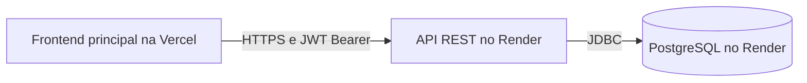
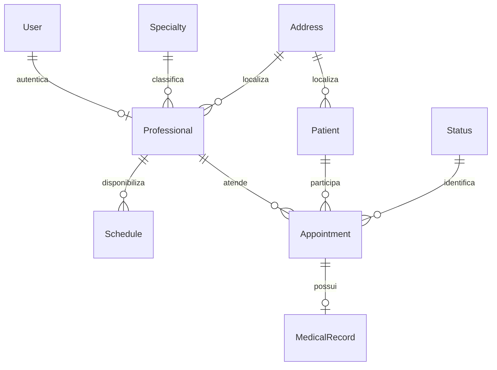
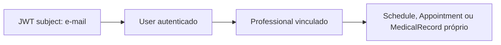
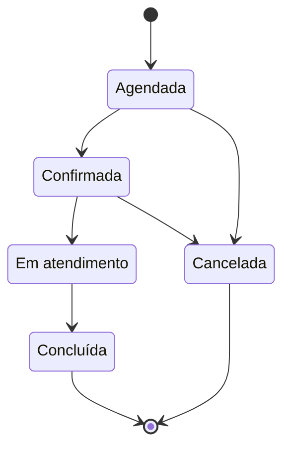

# Arquitetura do Backend +PraClinic

## 1. Visão geral

API REST em Java 26 e Spring Boot 4.1.1, com Spring MVC, Spring Security, Spring Data JPA/Hibernate, PostgreSQL 18 e Flyway. O Maven Wrapper empacota a aplicação, executada em Docker no Render.



API pública: https://praclinic-api.onrender.com. As rotas usam a base `/api`.

Frontend principal: https://praclinic.vercel.app. GitHub Pages permanece como publicação secundária/compatibilidade em https://carloseduardofurlan.github.io/GestaoDeClinicas-Frontend-ProjetoFinal-maisPraTi/.

## 2. Camadas

A aplicação fica na raiz; o pacote principal é `br.com.clinica`.

| Área | Responsabilidade |
| --- | --- |
| `controller` | Rotas HTTP, validação dos requests, códigos de resposta e delegação |
| `service` | Regras de negócio, transações, autorização por recurso e conversão para DTOs |
| `repository` | Consultas JPA, filtros por profissional, persistência e lock de disponibilidade |
| `entity` | Mapeamento de tabelas e relacionamentos |
| `dto/request` e `dto/response` | Contratos de entrada e saída, separados das entidades |
| `exception` | Exceções de negócio e resposta uniforme de erros |
| `security` e `config` | JWT, autenticação, perfis, ownership, CORS e infraestrutura |
| `mapper` e `validation` | Pacotes reservados; os mapeamentos atuais são manuais nos services, e as validações declarativas usam Jakarta Validation nos DTOs |

Migrations ficam em `src/main/resources/db/migration`, testes em `src/test/java` e CI em `.github/workflows/backend.yml`.

## 3. Domínio

| Entidade | Função |
| --- | --- |
| `User` | Identidade de acesso: nome, e-mail único, hash de senha e perfil |
| `Professional` | Registro único, contatos, especialidade, endereço e conta User |
| `Specialty` | Nome único e descrição opcional |
| `Patient` | Identificação, CPF único, nascimento, contatos, gênero e endereço |
| `Address` | Endereço de cadastros de pacientes e profissionais |
| `Schedule` | Disponibilidade por profissional, data e hora |
| `Appointment` | Consulta de paciente/profissional, data, hora, status e observação opcional |
| `Status` | Catálogo dos cinco estados oficiais |
| `MedicalRecord` | Texto clínico obrigatório (`notes`) ligado a uma única consulta |

Cardinalidades das FKs e constraints:



Cada Professional exige um User, mas um User pode não ter Professional. Cada MedicalRecord exige um Appointment, que pode ainda não ter prontuário. O schema não exige endereço exclusivo por cadastro. Appointment não possui FK para Schedule: o slot é localizado por profissional/data/hora.

## 4. Autenticação e segurança

`POST /api/auth/login` é público, recebe e-mail/senha e autentica com BCrypt. O JWT Bearer usa HS256, e-mail como subject e a claim `authorities`. O emissor é `clinica-api`; a duração configurada é 900 segundos.

`GET /api/auth/me` exige autenticação e retorna `userId`, `name`, `email`, `profile` e `professionalId`, que pode ser nulo. Respostas não expõem senha ou hash. Perfis reconhecidos: `ADMIN`, `RECEPTIONIST` e `PROFESSIONAL`.

A segurança é stateless, sem cadastro público, refresh token ou logout remoto. Rotas não autorizadas explicitamente são negadas. Token ausente/inválido/expirado gera 401; perfil sem permissão ou ownership negado gera 403.

## 5. API e matriz de acesso

Rotas por ID acrescentam `/{id}` quando oferecidas pelo controller. Listagens são arrays, sem contrato de paginação. DTOs/controllers/services são a referência detalhada de campos e limites.

| Recurso / base | ADMIN | RECEPTIONIST | PROFESSIONAL |
| --- | --- | --- | --- |
| `/api/auth` | Login e identidade própria | Login e identidade própria | Login e identidade própria |
| `/api/users` | Criar, listar, consultar, editar e excluir | Sem acesso | Sem acesso |
| `/api/patients` | Criar, listar, consultar e editar | Criar, listar, consultar e editar | Sem acesso global |
| `/api/professionals` | Criar, listar, consultar, editar e excluir | Leitura | Sem acesso global |
| `/api/specialties` | Criar, listar, consultar, editar e excluir | Leitura | Leitura |
| `/api/statuses` | Leitura | Leitura | Leitura |
| `/api/schedules` | Listar todos; criar para qualquer profissional | Listar todos | Listar e criar próprios |
| `/api/appointments` | Todos; criar, transicionar e cancelar | Todos; criar, confirmar e cancelar | Próprios; iniciar e concluir |
| `/api/medical-records` | Leitura global | Sem acesso | Ler, criar e editar próprios |

Não há escrita de Status, alteração/exclusão de Schedule ou exclusão de MedicalRecord. DELETE de Patient permanece bloqueado por HTTP.

### Ownership



O Professional é resolvido pelo usuário autenticado. IDs enviados pelo cliente são comparados com esse vínculo; não concedem autorização. Listagens de PROFESSIONAL são filtradas no repository. Recurso alheio ou vínculo ausente gera 403 nos serviços que exigem ownership.

## 6. Regras permanentes

- **User:** o e-mail de login não integra o DTO de atualização, que recebe nome, senha e perfil. Senhas usam BCrypt. A exclusão transacional deixa o PostgreSQL aplicar constraints: a FK pode remover o Professional associado sem dependências impeditivas; conflitos de integridade geram 409.
- **Professional:** criação de User/Address/Professional é transacional. Atualização cadastral preserva conta e credenciais. Excluir Professional não apaga User/Address; FKs protegem agenda e histórico.
- **Patient:** criação/edição recebem Address aninhado; edição preserva CPF e ID do endereço. Duplicidades cadastrais detectadas pelos services geram 400; conflitos de banco geram 409. DELETE HTTP bloqueado.
- **Specialty:** nome único; exclusão respeita vínculos. Não há atributo ativo/inativo no contrato de Professional.
- **Schedule:** UNIQUE em profissional/data/hora; duplicidade retorna 409 no pre-check e na constraint.
- **Appointment:** exige paciente, profissional e slot existentes; inicia em Agendada. A transação obtém lock pessimista no Schedule antes de verificar reserva ativa. Dupla reserva gera 409. Não há UNIQUE de reserva em Appointment nem FK para Schedule: a regra depende dessa transação.
- **Cancelamento:** DELETE de Appointment preserva o registro e muda para Cancelada. Só Agendada/Confirmada permitem cancelamento. O slot fica livre para outra reserva, com novo UUID.
- **MedicalRecord:** criação usa `appointmentId` e `notes`; resposta `id`, `appointmentId`, `notes`; edição apenas de notes. Há no máximo um por Appointment, garantido por UNIQUE; duplicidade gera 409. Não se exige status Concluída para criar; não há campos clínicos estruturados adicionais ou DELETE.
- Datas/horas clínicas usam LocalDate/LocalTime. Registros são identificados por UUID.

## 7. Máquina de estados



O catálogo contém Agendada, Confirmada, Em atendimento, Concluída e Cancelada. O status inicial é localizado por descrição, sem UUID fixo.

ADMIN executa qualquer transição válida. RECEPTIONIST confirma Agendada → Confirmada por PUT e cancela por DELETE. PROFESSIONAL inicia Confirmada → Em atendimento e conclui Em atendimento → Concluída, somente em consultas próprias. Transição inexistente gera 400; transição válida vedada ao ator gera 403. Concluída e Cancelada são finais.

## 8. Persistência

PostgreSQL 18 é o banco de referência. Flyway aplica V1–V15 na inicialização; as migrations são a fonte versionada do schema. Hibernate usa `ddl-auto=validate` e `open-in-view=false`. Não se criam tabelas manualmente para atender à aplicação.

V13 garante unicidade de Schedule; V14 mantém o catálogo de status; V15 mantém o prontuário em notes, preservando o conteúdo convertido e a unicidade por consulta. Evoluções de schema usam novas migrations, sem reescrever migrations aplicadas.

## 9. Erros HTTP

Formato uniforme: `timestamp`, `status`, `error`, `message`, `path`, `details`. Erros de validação incluem detalhes quando aplicável; falhas inesperadas não expõem detalhes internos.

| Código | Significado |
| --- | --- |
| 400 | Request, JSON, UUID ou regra de negócio inválidos |
| 401 | Autenticação ausente/inválida/expirada ou login incorreto |
| 403 | Perfil sem permissão ou ownership negado |
| 404 | Recurso inexistente em operação autorizada |
| 409 | Reserva, unicidade ou FK em conflito |
| 500 | Falha inesperada |

## 10. Configuração externa

| Variável | Uso |
| --- | --- |
| `DB_URL` | URL JDBC PostgreSQL do ambiente |
| `DB_USERNAME` | Usuário do banco |
| `DB_PASSWORD` | Senha do banco |
| `JWT_SECRET` | Base64 válido de pelo menos 32 bytes aleatórios reais para HS256 |
| `APP_CORS_ALLOWED_ORIGINS` | Origens HTTP(S) exatas separadas por vírgula |
| `PORT` | Porta de execução; padrão local 8080 |

Spring Boot não carrega `.env` automaticamente: configure o ambiente do processo/IDE. DB_URL não possui alias DATABASE_URL. Credenciais e chaves não pertencem a fonte, argumentos compartilhados, documentação, imagens ou Git.

CORS de produção permite exatamente `https://praclinic.vercel.app` (frontend principal) e `https://carloseduardofurlan.github.io` (publicação secundária), sem caminho do repositório ou barra final. A política é fechada por padrão, sem wildcard ou cookies/credentials; aceita Authorization/Content-Type e métodos GET/POST/PUT/DELETE/OPTIONS. CORS não autentica nem amplia permissões da API. Origens locais devem ser configuradas somente no backend do ambiente local.

## 11. Primeiro ADMIN

Não há ADMIN/senha padrão, seed de usuário real ou cadastro público. O ADMIN inicial é provisionado manualmente em sessão administrativa protegida, após Flyway e validação JPA.

O administrador escolhe nome, e-mail exclusivo e senha compatível com o contrato de até 20 caracteres. Gera o hash localmente com BCryptPasswordEncoder e confere matches antes do uso. A gravação administrativa usa parâmetros/transação, profile ADMIN e defaults de id/created. Deve-se verificar se já existe ADMIN antes de inserir e confirmar login e identidade por `/auth/me` ao terminar.

Nunca registrar senha, hash real ou SQL preenchido em arquivos/logs/Git. JWT_SECRET é independente da senha do ADMIN e vem de fonte criptograficamente segura. Após o bootstrap, a gestão de usuários usa a API autenticada, exclusiva de ADMIN.

## 12. Deploy e operação

O ambiente público possui contas de demonstração para ADMIN, RECEPTIONIST e PROFESSIONAL. As credenciais acadêmicas estão disponíveis no [README](../README.md#acesso-de-demonstração). A carga é administrativa, com dados fictícios, sem seed automático no deploy.

Docker multi-stage usa Eclipse Temurin Java 26: JDK/Maven Wrapper na compilação; JRE/JAR no runtime, com usuário sem privilégio. O build da imagem empacota com testes desabilitados; a suíte completa é um gate separado antes da promoção.

O Web Service `praclinic-api` no Render deve acompanhar a main estável e usar o Dockerfile da raiz. Banco e serviço precisam de conectividade adequada, preferencialmente na mesma região. Render termina HTTPS e fornece PORT; não se fixa porta do provedor no código. Secrets ficam no ambiente, fora da imagem. Flyway e JPA validate executam ao iniciar.

Não há health/Actuator público. Uma rota autenticada que retorna 401 não deve ser health check HTTP. O health check TCP verifica aceitação de conexões, não toda a aplicação.

O plano Free pode apresentar cold start. O cliente usa timeout de 120 segundos, sem garantir que todo wake-up termine nesse limite. Não há keepalive artificial. Capacidade, retenção e backups do PostgreSQL dependem do plano efetivo: confirme-os no painel, sem pressupor armazenamento durável para dados descartáveis.

## 13. Testes e CI

Com Java 26 e PostgreSQL 18 **exclusivo e descartável para testes**, configure DB_URL/DB_USERNAME/DB_PASSWORD desse banco e RUN_POSTGRES_TESTS=true:

```sh
./mvnw -B -ntp clean verify
```

Windows: `mvnw.cmd -B -ntp clean verify`. Nunca usar o banco Render de produção. Sem RUN_POSTGRES_TESTS=true, testes condicionais PostgreSQL são ignorados e não comprovam a integração completa.

A suíte cobre services, DTOs/controllers, segurança HTTP/JWT, ownership, migrations, persistência, concorrência e conflitos. **Backend validation** usa Java 26/PostgreSQL 18 descartável e Maven verify nas PRs para develop/main e nos pushes de integração configurados. Flyway e JPA validate integram esses testes; quantidade de casos não é cobertura percentual.
